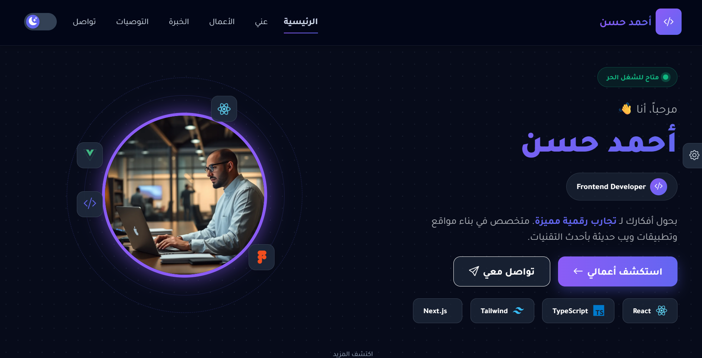

# 💼 Personal Portfolio Website

A modern, responsive, and interactive personal portfolio website built to showcase professional skills, projects, experience, and achievements through a clean and engaging user interface.

The website features a customizable appearance, dynamic content rendering, and an RTL layout designed to provide a smooth browsing experience.

## 🌐 Live Demo

[View Live Website](https://evronia.github.io/Personal-Portfolio-Website/)

## Screenshots
<p align="center">
  
</p>

## ✨ Features

- **Modern Hero Section:** An engaging introduction with a professional call to action.
- **About Me:** A personal introduction and overview of professional background.
- **Skills Showcase:** Interactive skill cards with animated proficiency indicators.
- **Projects Gallery:** A dynamic project showcase with category-based filtering.
- **Experience Timeline:** A structured timeline highlighting professional experience.
- **Testimonials Carousel:** An interactive slider displaying client feedback.
- **Statistics Section:** Visual presentation of professional achievements.
- **Contact Section:** Contact information and an interactive contact form.
- **Dark & Light Mode:** Switch between different display themes.
- **Theme Customization:** Choose from multiple color palettes.
- **Font Customization:** Switch between different font styles.
- **Persistent Preferences:** Save theme, colors, and font preferences using Local Storage.
- **Responsive Design:** Adapted for desktop, tablet, and mobile screens.
- **RTL Support:** Arabic right-to-left layout.

## 🛠️ Technologies Used

- HTML5
- CSS3
- JavaScript (Vanilla JS)
- Bootstrap 5 RTL
- Bootstrap Icons
- Devicon
- Google Fonts
- Local Storage API

## 📂 Project Structure

```text
Personal-Portfolio-Website/
│
├── assets/
│   ├── css/
│   │   └── style.css
│   │
│   ├── js/
│   │   └── index.js
│   │
│   └── imgs/
│       └── Images & Visual Assets
│
├── index.html
└── README.md
```

## 🚀 Getting Started

Follow these steps to run the project locally:

1. Clone the repository:

   ```bash
   git clone https://github.com/evronia/Personal-Portfolio-Website.git
   ```

2. Navigate to the project directory:

   ```bash
   cd Personal-Portfolio-Website
   ```

3. Open the project using Visual Studio Code.

4. Run `index.html` using the Live Server extension.

## 🎯 Project Purpose

This project demonstrates frontend development skills through building an interactive portfolio website, focusing on responsive layouts, dynamic DOM manipulation, reusable JavaScript rendering functions, UI customization, and browser storage.

## 👩‍💻 Developer

**Evronia Azmy**

Frontend Developer

- GitHub: [@evronia](https://github.com/evronia)

---

⭐ If you find this project useful, feel free to give it a star!
